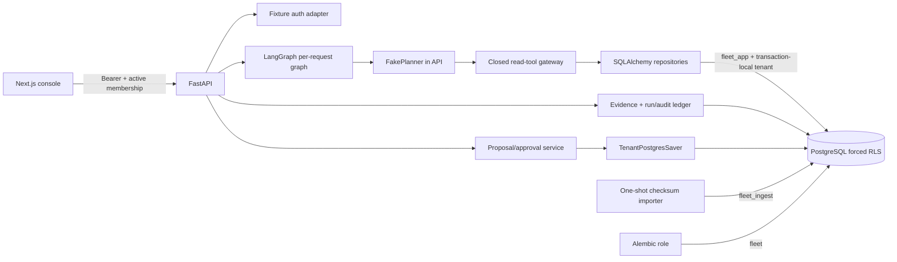

# Architecture and operational boundaries

## Runtime topology

Compose binds the web and API ports to loopback. The services share an internal Compose network; PostgreSQL is not host-published. The API and web containers use multi-stage images, non-root accounts, dropped capabilities, read-only roots and bounded temporary storage. PostgreSQL data is a named volume. Local Compose resource limits and health checks are in `docker-compose.yml`. There is no Redis or worker: analysis and the current approval workflow are synchronous, and checkpoints/audits use PostgreSQL.

`GET /api/v1/health` is process liveness. `GET /api/v1/ready` connects as the configured request DB role and checks owner/superuser/BYPASSRLS state plus the required forced-RLS tables and policies. The graph is in-process; `graph: available` in readiness is not an independent graph service probe.

## Identity and tenant boundary

With `DEMO_AUTH_MODE=false`, protected API routes reject fixture bearer tokens. `docker-compose.demo.yml` sets `APP_ENV=demo` and enables fixed `DEMO_PRINCIPALS`; each fixture maps to one tenant and one role. Production authentication/session issuance is absent. `X-Active-Tenant` selects a membership already attached to the authenticated principal. `fleet.api.context` opens a transaction, sets `app.tenant_id` transaction-locally using a parameterized statement, resolves the tenant, then yields the trusted `RequestContext`.

API requests use `fleet_app`: `NOSUPERUSER`, `NOBYPASSRLS`, and not a table owner. Tenant tables have `ENABLE ROW LEVEL SECURITY` and `FORCE ROW LEVEL SECURITY`; repositories also include tenant predicates. Migrations use `fleet`; full-file import runs separately as `fleet_ingest`. The request path does not accept model SQL. PostgreSQL integration tests verify the RLS path only when `TEST_DATABASE_APP_URL` is set to `fleet_app`; a privileged migration connection is not valid RLS evidence.

## Telemetry, query, and evidence path

The canonical source is `data/device-telemetry-dataset.ndjson`, a 750-row snapshot with a frozen SHA-256. `make seed`/`make ingest` validates the checksum, input types, and uniqueness, then imports using `fleet_ingest`. Latest inventory partitions by tenant and device, selects the latest observation at or before `as_of`, then applies filters and stable ordering. Disk free percent uses only the platform primary mount and `ROUND_HALF_UP` to two decimal places. Missing, invalid, or ambiguous measurements remain unknown. Battery health percentage is not derived from charge or capacity.

Reads can persist tenant-owned evidence pointers and aggregate manifests. Pointers identify an exact field path/value hash; manifests contain canonical filters, cutoff, numerator/denominator, coverage, matched/excluded source references, dataset hash and policy version. Resolvers re-read the source row under tenant scope. Foreign/missing IDs are opaque not-found. These hashes establish integrity relative to the stored records; they are not signatures or a defense against a privileged DB owner rewriting all records and heads.

## Agent graph

The graph is a compiled LangGraph `StateGraph` with explicit `plan`, `tools`, and `answer` nodes. Conditional edges allow multiple bounded calls and a plan-after-tool loop; max planning rounds are 3, total read calls 12, plan steps 4, question length 2,000 characters, history 8,000 characters, and answer length 4,000 characters. Tool schemas have their own limits, including page size 1–100, history up to 366 days/500 points, trends up to 5,000 observations, and evidence batches up to 100. Failed calls consume budget; automatic retry is not used.

The current API constructs `FakePlanner`, whose rules are a hardcoded keyword router (`disk`, `software`, `compliance`, `risk/insight`, and battery-health abstention). It is deterministic and testable but is not a meaningful general-purpose planning model. `ProviderPlanner` is a structured-output adapter contract only; no provider SDK/configuration is wired to API requests. When wired, it would receive the question and prior tool result payload as untrusted data, which creates provider data-sharing risk that needs a policy and deployment review.

Only the ten names in `READ_TOOL_NAMES` can be selected by the model. The trusted `RequestContext` is captured server-side. No action tool is available to the model. The assessment node validates output shape and ensures citations are among evidence/manifests from the run. It does **not** compare a free-form claim sentence against manifest values or run `evidence.verify_claim` for each claim. UI citation presence therefore proves pointer provenance, not semantic entailment. The deterministic planner emits generic row-count claims; this limitation is material for any future provider planner.

## Action proposal and approval path

`ProposalRequest`/`create_proposal` support `create_upgrade_order`, `open_remediation_ticket`, `flag_device_for_replacement`, and `notify_employee` with closed payload shapes. Service logic checks target/evidence tenant, manifest integrity, target scope, 70% minimum coverage, policy version, actual source failures for remediation tickets, and 24-hour proposal expiry. Evidence older than seven days is flagged historical for sandbox proposals and denied for real external mode. External adapters are disabled. Replacement is policy-denied. The action version and state machine are checked in the service; decision binds an approver to the exact canonical proposal hash and requires requester/approver separation by default.

The browser has a proposal form for upgrade orders, separate approval/rejection, and a separately confirmed operator sandbox execution step. The `POST /api/v1/actions/proposals/{proposal_id}/execute` route requires an operator/admin role and exact proposal hash, then delegates to `execute_proposal`, which checks approval/hash/expiry/status/idempotency and records a deterministic DB-only simulated effect. The current workspace has unit/service coverage for execution and route hash binding, but no PostgreSQL execution run or clean demo smoke run was possible here. The four gateway proposal tool names still return `PROPOSAL_NOT_YET_IMPLEMENTED`; they are not connected to `create_proposal` and are not in the model allowlist. `REAL_EXTERNAL` remains disabled.

## Audit, traces, and replay

State-changing approval/execution audits are in the same transaction as state changes. Agent run events are best-effort; a failed event write does not block a read. Run step summaries are tenant-scoped, hash-linked, and retention-capped. Audit chains use a zero sentinel and persisted tenant head; they detect local edits relative to that head but have no independent signature authority. Optional OTLP contains safe metadata only; prompts, source strings, and credentials are omitted.

`replay(run_id)` verifies and deterministically reprojects the stored sanitized tool-fact transcript and versions. It does not re-query PostgreSQL or make a provider call. The original user prompt and raw telemetry are intentionally not persisted, so narrative reproduction is unavailable.

## Build, demo, evaluation, and deployment

`make demo-up` starts DB, applies migrations, imports the pinned source, builds and starts API/web, and waits for health/readiness. `make demo-down` preserves the volume; `make demo-reset` deletes volumes. Demo credentials in `.env.example` are disposable and `.env` is ignored. External credentials and real integrations are intentionally unused. The demo and host development workflow are in `docs/DEMO.md`.

`make eval-offline` recomputes source oracles and runs a repeatable offline suite. `make eval-security` runs 41 current chaos probes and the security evaluator; PostgreSQL skips fail the release gate. See `docs/EVALUATION.md` and `docs/THREAT_REVIEW.md` for measured outcomes and gaps. Hypothetical production deployment needs managed TLS ingress, secret storage, production IdP, restricted egress/IAM, managed PostgreSQL with matching RLS roles, backups, and alerting; these are not implemented or certified here.
